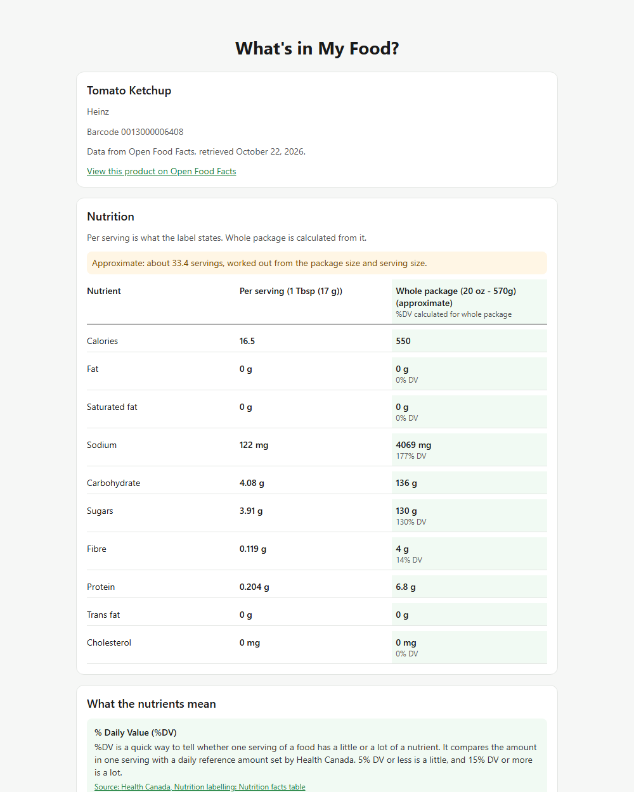

# What's in My Food?

ECE444 Software Engineering, University of Toronto, Fall 2026 · Group 20, Team Nexus

*What's in My Food?* helps shoppers understand packaged food without a nutrition background. Scan a product's barcode and see what is in it, explained in plain language with a source behind every statement.

**Try it:** https://whats-in-my-food.onrender.com (staging; the first visit after a quiet period takes about a minute while the server wakes up).

## Table of contents

- [Project overview](#project-overview)
- [Feature highlight: scan a product, see what's in it](#feature-highlight-scan-a-product-see-whats-in-it)
- [Quick start](#quick-start)
- [Status](#status)
- [What the app does](#what-the-app-does)
- [Project management](#project-management)
- [Tech stack](#tech-stack)
- [Staging](#staging)
- [Repository layout](#repository-layout)
- [Documentation](#documentation)
- [Team](#team)
- [Contributing](#contributing)
- [Acknowledgements](#acknowledgements)

## Project overview

**The problem.** The Nutrition Facts table is hard to read for most people. In a survey of 2,665 young Canadians, only 4% knew how to read both of Health Canada's %DV thresholds (5% is "a little", 15% is "a lot"), and the table gives values for one serving, which is often much less than the package people actually eat. Ingredient lists are just as hard: an unfamiliar additive name says nothing about what it is or why it is there. The sources are in [docs/requirements.md](docs/requirements.md#stakeholders).

**Who it is for.** Everyday shoppers in Canada who want to know what is in a packaged food but have no training in nutrition.

**What the app does.** The user scans a product's barcode with the phone camera or the webcam, or uploads a photo. The app looks the product up in [Open Food Facts](https://world.openfoodfacts.org/) and shows:

- calories and nutrients **per serving and for the whole package**;
- what each nutrient's amount and %DV mean, in plain language, using Health Canada's 5% / 15% rule;
- a **summary of the ingredients**, with reviewed explanations and sources for the ones that may be flagged;
- clear notices when data is missing, instead of guesses.

When the database has no nutrition data, the user can photograph the Nutrition Facts table. A vision model reads it, and the user confirms each value before the app uses it.

The app shows what is in the product and what credible authorities say. It gives no single health score or "good / bad" verdict.

## Feature highlight: scan a product, see what's in it



*The results page after scanning a bottle of Heinz Tomato Ketchup (barcode 0013000006408).*

**What it does.** One scan gives the whole analysis on one page:

1. **Product and source.** Name, brand, barcode, and where the data came from, with the date and a link to the product on Open Food Facts.
2. **Nutrition.** The label's per-serving values next to the whole package (tinted column), which the app calculates from the package size. If the servings per package are worked out rather than printed, it says so ("Approximate: about 33.4 servings").
3. **What the nutrients mean.** For each nutrient: whether its %DV is "a little" or "a lot", what the nutrient is, and links to Health Canada.
4. **Ingredients.** How many ingredients were checked, up to three flagged ones with the reason, and a detail screen for each with its sources.

Each section stands on its own: if one cannot be calculated, it says so, and the others still show.

**How to use it.**

1. Open https://whats-in-my-food.onrender.com on a computer or phone, or [run it locally](#quick-start).
2. Click **Scan live** and hold the barcode up to the webcam, or click **Upload photo** (**Take photo** on a phone) and choose a clear photo of the barcode.
3. The results page opens. **Scan another product** goes back to the scanner.

To try it without a product, scan the barcode in [docs/images/test-barcode.png](docs/images/test-barcode.png) (the same ketchup).

## Quick start

### Prerequisites

| Tool | Version | Needed for |
|---|---|---|
| Git | any | cloning |
| Python | 3.10 or newer | the backend |
| Node.js | 22 or newer (with npm) | the client |
| Docker | optional | a local PostgreSQL; no current code reads it |
| Expo Go app | optional | running the app on your phone |
| Gemini API key | optional, free at https://aistudio.google.com/apikey | reading Nutrition Facts photos; everything else works without it |

### Set up and run

```
git clone https://github.com/suyeon240park/ECE444-Group20.git
cd ECE444-Group20
```

**Backend** (terminal 1): installs the dependencies from `requirements-dev.txt` and starts the API on port 5000.

```
cd backend
python -m venv .venv
.venv\Scripts\activate          # Windows;  source .venv/bin/activate  on macOS / Linux
pip install -r requirements-dev.txt
copy .env.example .env          # Windows;  cp .env.example .env  on macOS / Linux
flask --app wsgi run --debug
```

Check that http://127.0.0.1:5000/api/health returns `{"status": "ok", ...}`.

**Client** (terminal 2): installs the dependencies from `package.json` and opens the app.

```
cd client
npm install
npm run web
```

The app opens at http://localhost:8081. The line at the bottom of the home screen says "Backend connected" when the client reaches the backend.

**Phone** (optional): install Expo Go, log in with a free Expo account, point the client at your computer's LAN IP in `client/.env`, run `npm start` and scan the QR code. Step-by-step instructions are in [client/README.md](client/README.md#run-on-a-phone-expo-go).

### Environment variables

Copy each `.env.example` to `.env` in the same folder. The defaults work for local development. Never commit a `.env` file.

`backend/.env`:

| Variable | Default | What it does |
|---|---|---|
| `GEMINI_API_KEY` | empty | Key for reading Nutrition Facts photos. Without it, the photo endpoints answer 503 and the rest of the app works. |
| `VISION_MODEL` | `gemini-3.5-flash` | Vision model for label photos. `VISION_FALLBACK_MODELS` lists the ones tried when it is overloaded. |
| `VISION_TIMEOUT_SECONDS` | `60` | How long to wait for the vision model. |
| `CORS_ORIGINS` | `*` | Comma-separated origins allowed to call the API. |
| `OFF_BASE_URL`, `OFF_USER_AGENT`, `OFF_TIMEOUT_SECONDS` | Open Food Facts defaults | Product database settings. |
| `PRODUCT_CACHE_TTL_SECONDS` | `86400` | How long found products stay cached (Open Food Facts allows 15 reads per minute). |
| `DATABASE_URL` | local Docker database | Reserved; no current code reads it. |
| `GIT_COMMIT` | `dev` | The commit `/api/health` reports. |

`client/.env`:

| Variable | Default | What it does |
|---|---|---|
| `EXPO_PUBLIC_API_BASE_URL` | `http://localhost:5000` | Where the app finds the backend. Use your LAN IP for a phone, or the staging backend. |
| `EXPO_PUBLIC_GIT_COMMIT` | not set | Set by the staging build; shown as "App build" on the home screen. |

### Run the tests

```
cd backend && pytest && ruff check . && ruff format --check .
cd client && npm run typecheck && npm run build:web
```

`pytest` runs the unit and end-to-end tests and fails below 80% coverage. The end-to-end tests replay recorded Open Food Facts and Gemini replies, so they need no API key or network. CI runs exactly these commands on every pull request. More detail is in [backend/README.md](backend/README.md) and [client/README.md](client/README.md).

## Status

| Milestone | State |
|---|---|
| M1: Team formation and project idea | Done |
| M2: Requirements engineering | Done. See [docs/requirements.md](docs/requirements.md) |
| M3: First sprint | Done. See [docs/M3-sprint-1-report.pdf](docs/M3-sprint-1-report.pdf) |
| M4: Second sprint | Done: scan to results page, nutrition, explanations, ingredients, staging |
| Sprint 3 (October 24 – November 20) | Next: the photo path in the app, Q1–Q3 measurements, release |

## What the app does

The scope for this semester is defined in [docs/requirements.md](docs/requirements.md). In short:

| ID | Requirement | Type | Story |
|---|---|---|---|
| F1 | Identify a packaged food by barcode and retrieve its food information, with Nutrition Facts OCR as a fallback | Functional | [#10](https://github.com/suyeon240park/ECE444-Group20/issues/10) |
| F2 | Display calories and nutrients for the entire package | Functional | [#2](https://github.com/suyeon240park/ECE444-Group20/issues/2) |
| F3 | Explain each nutrient in plain language with a credible source | Functional | [#3](https://github.com/suyeon240park/ECE444-Group20/issues/3) |
| F4 | Provide a quick, sourced ingredient summary for busy shoppers | Functional | [#9](https://github.com/suyeon240park/ECE444-Group20/issues/9) |
| Q1 | Nutrition values extracted from a label photo must match the printed label | Quality: accuracy | [#4](https://github.com/suyeon240park/ECE444-Group20/issues/4) |
| Q2 | Identify uploaded food products within an acceptable response time | Quality: performance | [#5](https://github.com/suyeon240park/ECE444-Group20/issues/5) |
| Q3 | Present food analysis that non-experts can understand and navigate without help | Quality: usability | [#11](https://github.com/suyeon240park/ECE444-Group20/issues/11) |

Deferred this semester: personalised allergen flagging ([#7](https://github.com/suyeon240park/ECE444-Group20/issues/7), [#8](https://github.com/suyeon240park/ECE444-Group20/issues/8)).

## Project management

The repository and the project board are public.

| Purpose | Tool | Link |
|---|---|---|
| Backlog, sprint planning and task board | GitHub Projects | https://github.com/users/suyeon240park/projects/2 |
| User stories, requirements review and implementation tasks | GitHub Issues | https://github.com/suyeon240park/ECE444-Group20/issues |
| Code review and merging | GitHub Pull Requests | https://github.com/suyeon240park/ECE444-Group20/pulls |
| Version control | Git and GitHub | https://github.com/suyeon240park/ECE444-Group20 |
| Continuous integration and staging deploys | GitHub Actions | https://github.com/suyeon240park/ECE444-Group20/actions |
| Staging hosting | Render (free tier) | see [Staging](#staging) |
| Day-to-day communication | Discord (private team server) | not public |
| Scheduling meetings | When2Meet | https://www.when2meet.com/ |
| Meeting minutes | AI notetaker in team meetings, corrected by hand when needed | not public |

How we use them:

- **Backlog.** Selected user stories are sorted by priority on the project board. Each story is a GitHub issue labelled `candidate-story` plus `functional` or `quality`.
- **Tasks.** Each story is broken into implementation issues that link back to the story and to its section of the requirements document. Tasks move through Todo, In Progress and Done on the board.
- **Sprints.** We plan each sprint at a meeting, record estimated hours per task before starting, and compare them with actual hours at the end. Sprint reports are stored in [docs/](docs/).
- **Process.** Roles, meeting times and conflict resolution are in the [Team Workflow Document](Team_Workflow_Document.md). That document originally named Jira for task tracking; the team uses GitHub Projects instead.

## Tech stack

Set up in sprint 1 (issue #19).

| Layer | Choice | Why |
|---|---|---|
| Client (web and mobile) | React Native with Expo SDK 57 and TypeScript, built for web, iOS and Android from one codebase | One codebase covers the browser and phones; the camera and barcode scanner come built in |
| Backend API | Python 3.10+ with Flask | The course labs use Flask, and Python has the strongest image and data tooling |
| Database | PostgreSQL 16 (local instance via Docker Compose) | Reserved for future persistence; not used by current code |
| Ingredient content | Versioned JSON in `backend/content/ingredients/entries/` | 50 reviewed, sourced entries (#34, #35), validated and loaded at startup; every change is reviewed in a pull request |
| Product data | Open Food Facts API | Free, open, queried by barcode |
| Nutrition Facts extraction | Google Gemini vision model (`gemini-3.5-flash`, with fallback models), chosen from the #16 prototype | Read all 166 values on the first 10 test photos correctly; the user confirms every value before it is used (Q1) |
| Tests and CI | pytest and ruff for the backend, TypeScript and an Expo web build for the client, GitHub Actions | Runs on every pull request and on `main` |
| Staging hosting | Render free tier: backend as a web service, Expo web build as a static site (#22) | Free, builds from the public repository, and CI can trigger deploys through deploy hooks |

## Staging

The latest `main` runs on Render's free tier (#22):

- App: https://whats-in-my-food.onrender.com
- Backend health check: https://whats-in-my-food-api.onrender.com/api/health

A merge to `main` is deployed automatically once CI passes. The home screen shows the commit of the app build and of the backend, so you can check that staging is up to date. The backend sleeps after 15 minutes without traffic, so the first request after a quiet period takes about a minute. Setup, settings and limits: [docs/deployment.md](docs/deployment.md).

## Repository layout

```
.
├── backend/                     Flask API: app/ (factory, route blueprints, models), tests/, wsgi.py
├── client/                      Expo app: App.tsx, src/ (API calls, screens, components), assets/
├── tests/
│   └── fixtures/
│       └── nutrition_labels/    benchmark photos and ground truth for requirement Q1 (#17)
├── docs/
│   ├── requirements.md          project goal, stakeholders, scope, selected requirements
│   ├── deployment.md            staging on Render: setup, settings, limits (#22)
│   ├── M3-sprint-1-report.pdf   sprint reports (Milestones 3 and 4)
│   ├── images/                  README screenshot and a test barcode
│   ├── validation/              checks of the ingredient content against real products
│   └── api/                     client–backend API contract: openapi.yaml + README.md (#20)
├── .github/workflows/ci.yml     backend lint + tests, client typecheck + web build, staging deploy
├── docker-compose.yml           local PostgreSQL
├── README.md                    this file
├── CONTRIBUTING.md              how we branch, review and merge
├── CODE_OF_CONDUCT.md           how we treat each other
├── Team_Workflow_Document.md    roles, meetings, conflict resolution
└── team_members.md              names, roles, emails
```

## Documentation

- [Requirements](docs/requirements.md)
- [Product API contract](docs/api/README.md)
- [Staging deployment](docs/deployment.md)
- [Team Workflow Document](Team_Workflow_Document.md)
- [Team members](team_members.md)
- [Contributing guide](CONTRIBUTING.md)
- [Code of Conduct](CODE_OF_CONDUCT.md)

## Team

| Name | Role | Email |
|---|---|---|
| Suyeon Park | Backend Developer | suyeon.park@mail.utoronto.ca |
| Frank Liu | Software Lead | frankqt.liu@mail.utoronto.ca |
| Eyad Ahmed | Project Manager / Frontend Developer | eyad.ahmed@mail.utoronto.ca |
| Alex An | Full-Stack Developer | alex.an@mail.utoronto.ca |

## Contributing

Work happens on branches and reaches `main` only through a reviewed pull request. Read [CONTRIBUTING.md](CONTRIBUTING.md) before you start, and follow the [Code of Conduct](CODE_OF_CONDUCT.md).

## Acknowledgements

- README structure adapted from the [Best-README-Template](https://github.com/othneildrew/Best-README-Template).
- Product data from [Open Food Facts](https://world.openfoodfacts.org/).
- Nutrition guidance from [Health Canada](https://www.canada.ca/en/health-canada/services/food-nutrition/nutrition-labelling.html).
